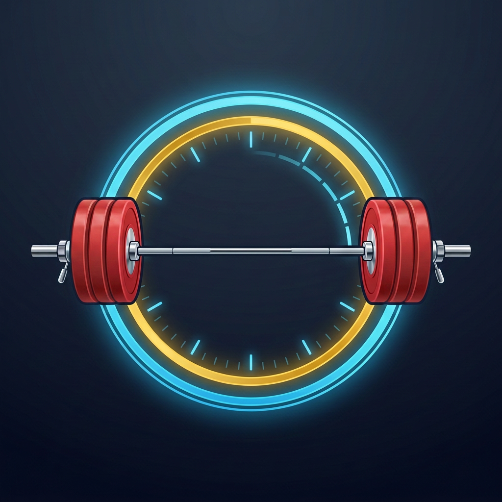
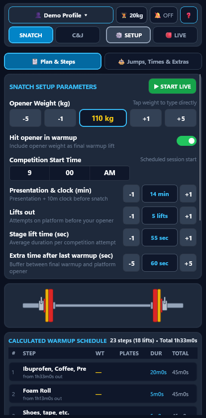
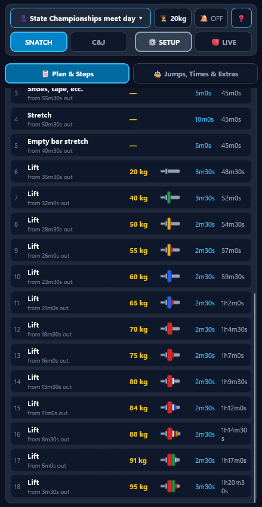
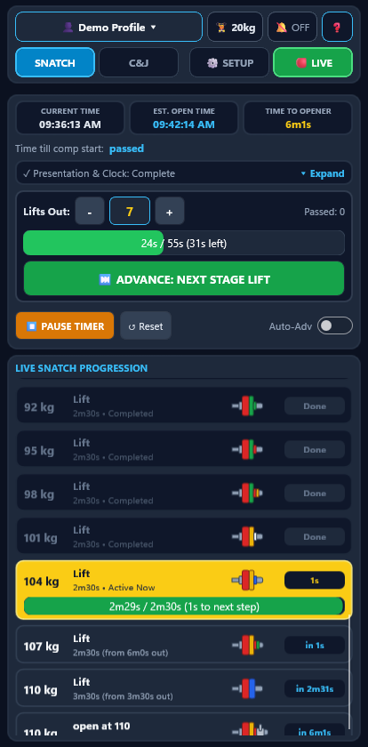
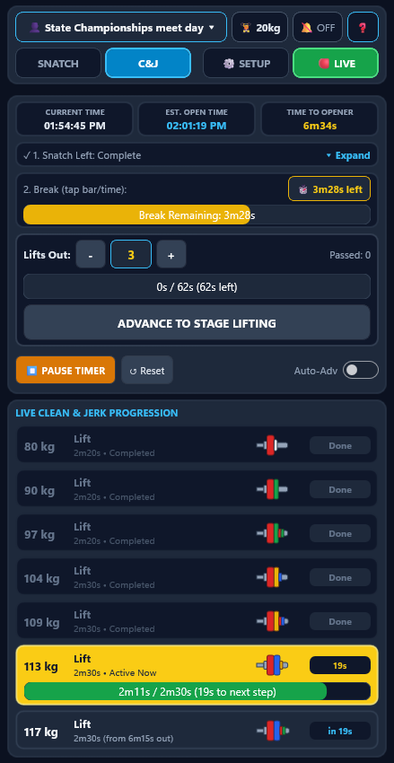
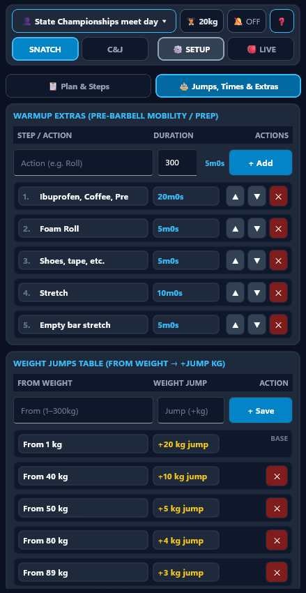
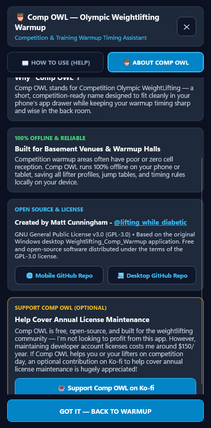
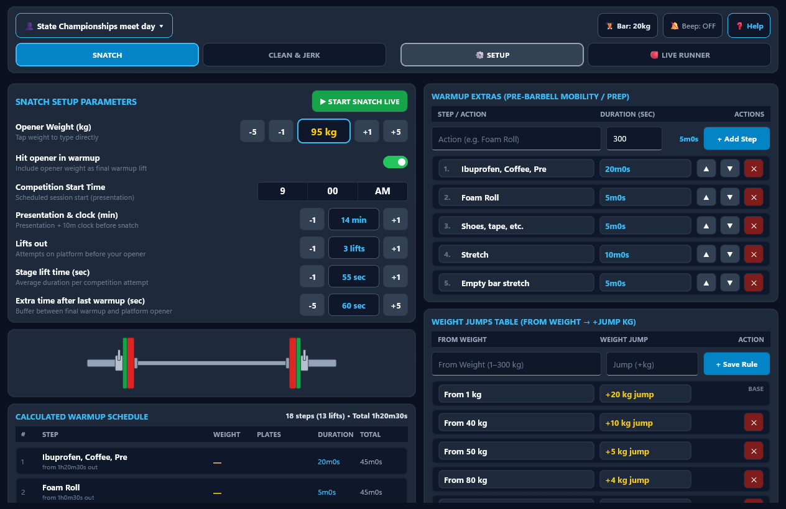
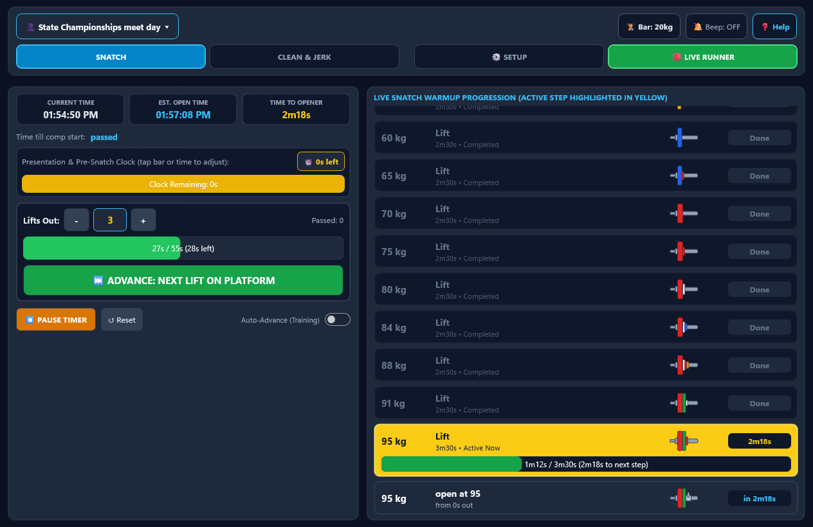

<div align="center">
  

  # Comp OWL — Weightlifting Comp Warmup

  **Competition Olympic WeightLifting Warmup Timer & Plate Calculator for Android & iOS**

  [-38BDF8?style=flat-square)](./src/WeightliftingCompWarmup.Maui/WeightliftingCompWarmup.Maui.csproj)
  [-4ADE80?style=flat-square)](./src/WeightliftingCompWarmup.Maui)
  [](./LICENSE)
  [](./PRIVACY.md)
  [](https://ko-fi.com/compowlapp)
</div>

---

## Overview

**Comp OWL** (**Comp**etition **O**lympic **W**eight**L**ifting) is a cross-platform **.NET MAUI** mobile and tablet application for **Android (Phones & Tablets)** and **iOS (iPhones & iPads)**. It is the mobile companion to the original `.NET WinForms` [Weightlifting_Comp_Warmup](https://github.com/dyaballikl/Weightlifting_Comp_Warmup) desktop app, designed for lifters, coaches, and competition handlers in the warmup room.

Enter your lifter's **Snatch** or **Clean & Jerk** opener, barbell type, weight-jump rules, and rest timing, and Comp OWL works backward from platform time to generate a complete, step-by-step warmup schedule with color-coded IWF barbell loading and live countdown clocks.

- **Current Release:** `v2.0.15` (Build `17`)
- **Created by:** Matt Cunningham ([@lifting_while_diabetic](https://www.instagram.com/lifting_while_diabetic/) on Instagram)

---

## Screenshots

### 📱 Phone Layout (Portrait)
| Snatch Setup & Opener | Warmup Schedule & Plates | Snatch LIVE Countdown | Clean & Jerk 3-Phase LIVE |
| :---: | :---: | :---: | :---: |
|  |  |  |  |

| Jumps, Times & Extras | About & Ko-fi Support |
| :---: | :---: |
|  |  |

### 💻 Tablet / iPad 2-Column Split Dashboard (Landscape)
| Setup & Schedule Split Dashboard | Live Competition Split Dashboard |
| :---: | :---: |
|  |  |

---

## Key Features

### 🏋️ Reverse-Calculated Warmup Progression
- **Custom Jump & Rest Rules:** Configure two-tier weight jumps (e.g., normal jump below a threshold weight, smaller jump as you approach your opener) and rest intervals by weight bracket.
- **Final-Jump Midpoint Smoothing:** Optional toggle to smooth the final two warmup jumps when the transition into your opener would otherwise be uneven.
- **Custom Pre-Warmup Items:** Insert foam rolling, dynamic mobility, empty bar work, or shoe/belt prep steps into the schedule so your entire back-room routine is timed from the first movement.
- **Extra Buffer Before Opener:** Configurable buffer time (`90s` default) between your last warmup lift in the back room and walking out to the competition platform.

### 🎨 Authentic IWF Barbell & Plate Graphics
- **Color-Coded Competition Plates:** Vector-rendered barbell sleeves showing standard IWF bumper plates (`25 kg` red, `20 kg` blue, `15 kg` yellow, `10 kg` green), `2.5 kg` competition collars, and fractional change plates (`5 kg` down to `0.5 kg`) outside the collars.
- **Full-Size Technique Plates:** Automatically uses full-size (`50 cm` diameter) `5 kg` white and `2.5 kg` red plastic technique plates when the barbell is loaded lighter than the green `10 kg` plate minimum.
- **Multiple Bar Types:** Supports `20 kg` Men's, `15 kg` Women's, and `10 kg` Youth/Technique barbells.

### ⏱️ Live Competition Countdown Modes
- **Snatch LIVE Mode:**
  - Tracks competition start time (optional), `10m` athlete presentation + `5m` post-presentation buffer, or direct stage-lift countdown (`N lifts out` from your opener).
  - Quick-action buttons (`-1 Lift`, `+1 Lift`, `Reset Lift`, `+1m`, `+2m`) to react immediately when another lifter changes their opener or the jury pauses the clock.
- **Clean & Jerk LIVE Mode:**
  - Seamless 3-phase countdown: **Snatch Attempts Remaining** (`90s/lift` default) → **Intermission Break After Snatch** (`10m` default) → **C&J Stage Lifts Out** (`60s/lift` default).
- **Touch-Scrubbable Progress Bars:** Tap or drag directly on any active stage or break progress bar to scrub the clock forward or backward to match the venue's marshalling screen.
- **Wake-Lock & Audio/Haptic Alerts:** Keeps your screen awake during live sessions and triggers a `750 Hz` tone + haptic vibration whenever the next warmup step arrives.

### 📱 Built for the Warmup Room
- **Adaptive Phone & Tablet Layout:** Automatically switches between a compact tabbed phone interface (`< 760dp`) and a 2-column split dashboard on tablets and iPads (`>= 760dp`).
- **Multi-Lifter Profiles:** Save, duplicate, rename, and switch between multiple athlete profiles on the same device.
- **100% Offline & Private:** Zero internet connection required—ideal for basement venues and warmup halls with poor cell reception.

> [!IMPORTANT]
> **Competition Day Reminder:** Comp OWL is **not** connected to the competition's electronic refereeing or marshalling software. Always keep an eye on the official warmup room scoreboard—other athletes changing their attempts, 2-minute self-follow clocks, or jury pauses can rapidly move your platform time forward or back.

---

## Solution Structure

- `src/WeightliftingCompWarmup.Core/` — Pure C# domain & calculation library:
  - [`Models/DataTypes.cs`](./src/WeightliftingCompWarmup.Core/Models/DataTypes.cs) — `Profile`, `WarmupStep`, `ExtraItem`, `WeightJumpRule`, `WarmupTimeRule`, and `LiftType`.
  - [`Services/Defaults.cs`](./src/WeightliftingCompWarmup.Core/Services/Defaults.cs) — Baseline defaults and pre-configured `"Demo Profile"`.
  - [`Services/WarmupCalculator.cs`](./src/WeightliftingCompWarmup.Core/Services/WarmupCalculator.cs) — Warmup weight progression generator (`CalculateWarmupWeights`), two-phase jump threshold lookup (`GetJumpForWeight`), final-jump midpoint smoothing (`SmoothLastJumps`), and reverse countdown builder (`BuildSteps` / `BuildLiveSteps`).
  - [`Services/BarbellLoadCalculator.cs`](./src/WeightliftingCompWarmup.Core/Services/BarbellLoadCalculator.cs) — IWF plate and `2.5 kg` collar layout engine (`Calculate`), including full-size plastic `5 kg` white / `2.5 kg` red technique plates below the `10 kg` green minimum and change plates outside the collar.
  - [`Services/LiveWarmupSession.cs`](./src/WeightliftingCompWarmup.Core/Services/LiveWarmupSession.cs) — Stateful 1-second tick engine for **Snatch LIVE** and 3-phase **Clean & Jerk LIVE** countdowns.
  - [`Services/ProfileStorageService.cs`](./src/WeightliftingCompWarmup.Core/Services/ProfileStorageService.cs) — Local JSON persistence for athlete profiles.
- `src/WeightliftingCompWarmup.Maui/` — Cross-platform `.NET 10 MAUI` mobile & tablet app:
  - [`Views/MainPage.cs`](./src/WeightliftingCompWarmup.Maui/Views/MainPage.cs) — Adaptive responsive UI switching between a **2-Column Split Dashboard** on Tablets/iPads and a **Segmented Compact Layout** on Phones.
  - [`Views/HelpAboutModalPage.cs`](./src/WeightliftingCompWarmup.Maui/Views/HelpAboutModalPage.cs) — Tabbed **How to Use (Help)** and **About Comp OWL** modal (`❓` button in the header bar).
  - [`Controls/BarbellPlateView.cs`](./src/WeightliftingCompWarmup.Maui/Controls/BarbellPlateView.cs) — Custom `GraphicsView` + `IDrawable` renderer for full two-sided opener barbells and compact single-sleeve lift rows.
  - [`Controls/ScrubbableProgressBar.cs`](./src/WeightliftingCompWarmup.Maui/Controls/ScrubbableProgressBar.cs) — Touch-scrubbable progress bar for live clock adjustments.
  - [`Services/DevicePlatformService.cs`](./src/WeightliftingCompWarmup.Maui/Services/DevicePlatformService.cs) — Screen wake-lock (`DeviceDisplay.Current.KeepScreenOn`) and `750 Hz` step transition audio + haptic alert.
  - [`ViewModels/MainViewModel.cs`](./src/WeightliftingCompWarmup.Maui/ViewModels/MainViewModel.cs) — MVVM state and commands for Setup and Live modes.
- `tests/WeightliftingCompWarmup.Tests/` — xUnit test suite covering warmup math, midpoint smoothing, IWF plate loading, live countdown state machines, and profile persistence.

---

## Building, Testing & Packaging

### 1. Run Unit Tests
```powershell
dotnet test
```

### 2. Package Android `.apk` & Google Play `.aab`
The [`package-apps.ps1`](./package-apps.ps1) script automatically increments the patch version and build number across the project, clears cached icon/resource artifacts, and builds both the sideloadable `.apk` and signed Play Store `.aab`:
```powershell
# Auto-increment version and build Android packages
powershell -ExecutionPolicy Bypass -File .\package-apps.ps1 -AndroidOnly

# Rebuild current version without bumping version numbers
powershell -ExecutionPolicy Bypass -File .\package-apps.ps1 -AndroidOnly -NoVersionBump
```

---

## License, Privacy & Support

- **License:** Licensed under the **GNU General Public License v3.0** — see [LICENSE](./LICENSE) for details.
- **Privacy Policy:** Comp OWL runs 100% offline and collects zero personal data — see [PRIVACY.md](./PRIVACY.md) for the full store-compliant privacy policy.
- **Support Comp OWL (Optional):** Comp OWL is free, open-source, and not built for profit. However, maintaining developer account licenses costs around \$150/year. If Comp OWL helps you or your lifters on competition day, you can optionally chip in toward annual license maintenance at [ko-fi.com/compowlapp](https://ko-fi.com/compowlapp).
- **Contact:** [@lifting_while_diabetic](https://www.instagram.com/lifting_while_diabetic/) on Instagram or `dyaballikl@gmail.com`.
